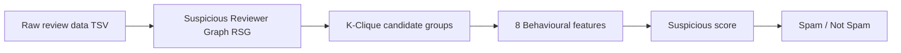

<p align="center">
  
  
  
  
</p>

<h1 align="center">🛡️ Spotting Spammers Using Group Spammer Behaviour Analysis</h1>

<p align="center">
  <strong>Unsupervised detection of coordinated review spam via K-Clique clustering and 8 behavioural features</strong>
</p>

<p align="center">
  <a href="#-overview">Overview</a> •
  <a href="#-how-it-works">How It Works</a> •
  <a href="#-features">Features</a> •
  <a href="#-quick-start">Quick Start</a> •
  <a href="#-project-structure">Structure</a> •
  <a href="#-data-format">Data Format</a> •
  <a href="#-tech-stack">Tech Stack</a>
</p>

---

## 📖 Overview

This project detects **group spam** in product reviews by analyzing **collective reviewer behaviour** instead of single-review content. Unlike traditional spam filters that look at one review at a time, this system finds **suspicious reviewer groups** that act in coordination—similar ratings, tight time windows, and shared products—and scores them using **8 behavioural features**. It is fully **unsupervised**: no labelled spam data is required for training.

Built for review platforms (e.g. Yelp-style sites). The pipeline is **dataset-agnostic** and works with any tab-separated review data in the expected format; results in the project use the **Yelp dataset**.

| What it does | How |
|--------------|-----|
| **Finds suspicious reviewer pairs** | Builds a *Reviewer Suspicious Graph (RSG)*: reviewers who co-reviewed the same product with similar rating and close time (≤60 days, rating diff &lt; 2) are linked. |
| **Finds groups** | Extracts **K-cliques** (k≥3): groups where every pair has enough “suspicious” co-review strength. |
| **Scores groups** | Computes **8 behavioural features** per group and aggregates into a **suspicious score**. |
| **Classifies reviewers** | Reviewers in high-scoring groups → **Spam**; others → **Not Spam**. |

---

## 🔬 How It Works

End-to-end pipeline:



Text flow:

```
┌─────────────────┐     ┌──────────────────┐     ┌─────────────────┐     ┌─────────────────┐
│  Raw review     │     │  Suspicious      │     │  K-Clique       │     │  8 Behavioural  │
│  data (TSV)     │ ──► │  Reviewer Graph  │ ──► │  candidate      │ ──► │  features +     │
│                 │     │  (RSG)           │     │  groups         │     │  suspicious     │
└─────────────────┘     └──────────────────┘     └──────────────────┘     │  score         │
                                                                            └────────┬────────┘
                                                                                     │
                                                                                     ▼
                                                                            ┌─────────────────┐
                                                                            │  Spam / Not     │
                                                                            │  Spam prediction│
                                                                            └─────────────────┘
```

### 1. Suspicious Reviewer Graph (RSG)

- **Input:** Tab-separated reviews with `reviewerID`, `asin`, `overall`, `reviewTime`, etc.
- **Rule:** Two reviewers are connected if they reviewed the **same product** with:
  - **Rating difference** &lt; 2  
  - **Time difference** ≤ 60 days (`alpha = 60`)
- **Output:** Edge list of reviewer pairs + count of such “suspicious” common products.

### 2. K-Clique candidate groups

- **Idea:** Spammers often work in **groups**. We want sets of reviewers where **every pair** in the set has sufficient suspicious co-review strength.
- **Method:** Build a graph from RSG, then extract **cliques** (e.g. minimum size **k = 3**). These form **candidate spam groups**.

### 3. Eight behavioural features (per group)

Each candidate group is scored using **8 normalized features**; the **suspicious score** is the average of these eight.

| # | Feature | Short | Description |
|---|---------|--------|-------------|
| 1 | **Average Rating Deviation** | AVG | Average (per review) absolute deviation from the product’s average rating, normalized (e.g. by 4). |
| 2 | **Group Deviation** | GD | Variance of ratings within the group on common products; passed through sigmoid + penalty by group/product sizes. |
| 3 | **Review Burst Ratio** | BS | Fraction of a reviewer’s reviews that fall in “burst” windows. Bursts are found via **KDE** on review dates per product. |
| 4 | **Group Size** | GS | Sigmoid of group size (e.g. `1/(1+exp(-(Rg-3)))`). |
| 5 | **Group Size Ratio** | GSR | Per product: (group size) / (number of reviewers who reviewed that product); then averaged and normalized. |
| 6 | **Review Tightness** | RT | Proportion of (reviewer, product) pairs in the group that actually have reviews, with a size penalty. |
| 7 | **Group Support Count** | — | Number of distinct products reviewed by the group; normalized by max across groups. |
| 8 | **Group Content Similarity** | GCS | For pairs of reviewers who co-reviewed the same product: **cosine similarity** of review text (after stopword removal); aggregated per group. |

---

## ✨ Features

- **Unsupervised:** No need for labelled spam data; discovers suspicious groups from behaviour only.
- **Group-centric:** Targets **coordinated** spam (multiple reviewers acting together), not just single-review spam.
- **Interpretable:** Each prediction can be explained via group membership and the 8 feature values.
- **Web UI:** Django app with shop, product detail, and **live spam prediction** on new reviews (using a pre-trained pickle model).
- **Evaluation:** Accuracy, confusion matrix, precision/recall/F-score (from `sklearn.metrics`).

---

## 🚀 Quick Start

### Prerequisites

- **Python 3.7+**
- **PostgreSQL** (database `fyp`, user `postgres`; password in `fyp/settings.py`)
- **NLTK data:** `stopwords`, `punkt` (see below)

### 1. Clone and setup environment

```bash
git clone https://github.com/YOUR_USERNAME/Spotting-Spammer-Using-Group-Spammer-Behaviour-Analysis.git
cd Spotting-Spammer-Using-Group-Spammer-Behaviour-Analysis
python -m venv venv
source venv/bin/activate   # On Windows: venv\Scripts\activate
pip install -r requirements.txt
```

### 2. Download NLTK data (required for Group Content Similarity)

```python
python -c "import nltk; nltk.download('stopwords'); nltk.download('punkt')"
```

### 3. Database

Create a PostgreSQL database named `fyp` and user `postgres` (or adjust `fyp/settings.py`). Then:

```bash
python manage.py migrate
```

### 4. Train the spam model (one-time)

Place your tab-separated review file (e.g. `raw_data.csv`) in the project root with columns: `reviewerID`, `asin`, `label`, `overall`, `reviewTime`, `reviewText`. Then train and save the model:

```python
from store import model

m = model.Model("./raw_data.csv")
m.save("./demo_model.pickle")
print("Model trained and saved.")
```

Or temporarily uncomment the train/save lines in `store/views.py` (in `productdetail`), run the app once so one request triggers training, then comment them back and use `Model.load()` only.

### 5. Run the web app

Ensure `demo_model.pickle` exists in the project root (from step 4). Then:

```bash
python manage.py runserver
```

Open **http://127.0.0.1:8000/** — browse products, submit a review, and see the **spam / not spam** result with feature breakdown.

---

## 📁 Project Structure

```
Spotting-Spammer-Using-Group-Spammer-Behaviour-Analysis/
├── manage.py                 # Django CLI entry (runserver, migrate, etc.)
├── demo_model.pickle         # Pre-trained model (create via training step)
├── raw_data.csv              # Your TSV review data (not in repo)
├── requirements.txt          # Python dependencies
│
├── fyp/                      # Django project config
│   ├── settings.py           # DB, apps, static, media
│   ├── urls.py               # Root URLconf → store + admin
│   └── wsgi.py
│
├── store/                    # Main app: spam model + web
│   ├── model.py              # ★ Core: RSG, K-cliques, 8 features, predict, save/load
│   ├── models.py             # Django ORM: Review, Product, Reviewer
│   ├── views.py              # Shop, product detail, review submit, model load/predict
│   ├── urls.py               # App routes (shop, product-detail, auth, etc.)
│   └── admin.py              # Admin for Review, Product, Reviewer
│
├── Templates/                # HTML (index, shop, product-detail, auth, cart, etc.)
└── static/                   # CSS, JS, SASS, fonts (Bootstrap, custom)
```

---

## 📄 Data Format

### Training input (for building `demo_model.pickle`)

**Format:** Tab-separated CSV (e.g. `raw_data.csv`).

| Column       | Description |
|-------------|-------------|
| `reviewerID` | Reviewer identifier |
| `asin`       | Product ID |
| `label`      | Ground truth: e.g. `1` = spam, `-1` = not spam (for evaluation) |
| `overall`    | Rating (e.g. 1–5) |
| `reviewTime` | Date in `YYYY-MM-DD` |
| `reviewText` | Review body (used for Group Content Similarity) |

Example (conceptual):

```text
reviewerID	asin	label	overall	reviewTime	reviewText
user_1	B001	1	5	2019-01-15	Great product!
user_2	B001	-1	4	2019-02-01	Good value.
```

Compatible with Yelp-style datasets; the pipeline is generic over any TSV with these columns.

---

## 🧪 Using the model in code

```python
from store import model

# Load pre-trained model
loaded = model.Model.load("./demo_model.pickle")

# Metrics on training data
print("Accuracy:", loaded.accuracy_score())
print("Confusion matrix:\n", loaded.confusion_matrix())

# Predict for one new review
result = loaded.predict(
    R_id=42,           # reviewer ID
    p_id=414,          # product ID
    rating=5.0,
    label=-1,           # unknown (for evaluation use 1 or -1)
    date="2012-09-23"
)
print(result)  # "Not Spam" or detailed spam breakdown with group and features
```

---

## 🛠 Tech Stack

| Layer    | Technology |
|----------|------------|
| Backend  | Python 3.7+, Django 2.2 |
| Database | PostgreSQL |
| ML/Data  | pandas, numpy, scikit-learn (KernelDensity, metrics), NetworkX |
| NLP      | NLTK (stopwords, word_tokenize for GCS) |
| Frontend | HTML/CSS/JS, Bootstrap, jQuery |

---

## 🖥️ Web app at a glance

| Page | Description |
|------|-------------|
| **Home** | Landing and navigation |
| **Shop** | Product listing with category and price filters |
| **Product detail** | Product info + **submit review** → model runs **live spam prediction** and shows result (Spam / Not Spam + feature breakdown) |
| **Auth** | Register, login, logout |

The product-detail view loads the pre-trained `demo_model.pickle`, runs `predict()` on the new review, and stores the result in the `Review.Spam` field.

---

## 📜 License

This project is available for educational and portfolio use. If you use the dataset, comply with the source (e.g. Yelp) terms.

---

## 📚 References

- Documentation and a high-level overview are provided in the **project presentation** (see repo history / commit 2).
- The approach is based on **group spammer behaviour**: detecting coordinated groups via graph (RSG), cliques, and behavioural features rather than content-only classifiers.

---

<p align="center">
  <strong>⭐ If this repo helped you or you use it in your work, consider giving it a star.</strong>
</p>
